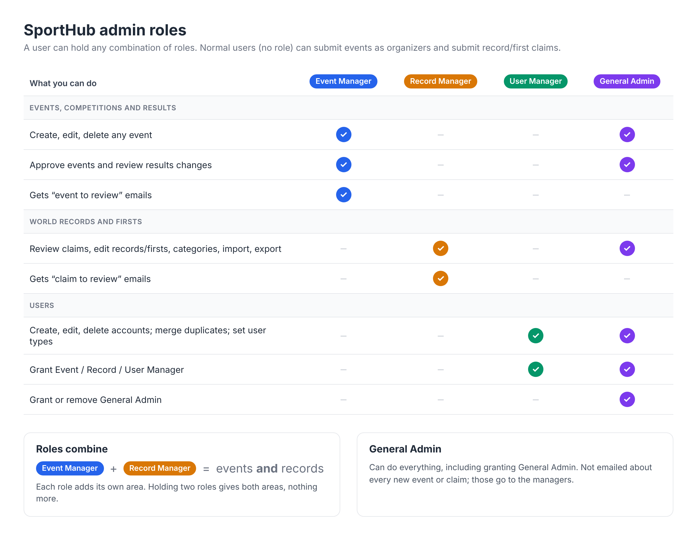

# Roles and permissions

SportHub has one kind of account. What an account may do beyond the public site depends on its **admin roles**. An account can hold **no role, one role or several roles at once**.

## The roles

| Role | Responsible for | Admin pages |
|---|---|---|
| *(none)* | Normal user: edit own profile, submit record/first claims, submit events as an organizer (user type *organizer*) | none |
| **Event Manager** | Events, competitions and results | Submit Event, Event Approval, Score Review |
| **Record Manager** | World records and firsts | Records review queue, Modify Records / Firsts / Categories, Import review, Export CSV |
| **User Manager** | User accounts | Manage Users, Duplicate Accounts |
| **General Admin** | Everything | All of the above |

## Three rules

1. **Roles combine.** Someone who is Event Manager and Record Manager can do everything both roles can. Nothing more: neither role gives access to user accounts.
2. **General Admin can do anything**, including the one thing no other role can: granting General Admin.
3. **Only a General Admin can make someone General Admin** (or take it away). A User Manager can grant and remove Event, Record and User Manager, and set user types (athlete, judge, organizer), but not General Admin. So nobody can promote themselves to General Admin.

## Who gets emails

Review emails go to the people responsible, not to General Admins:

| Something happens | Who is emailed |
|---|---|
| A record or first claim is submitted, or resubmitted after changes were requested | Every **Record Manager** ("New / Revised claim to review"). If nobody has the role: `RECORDS_REVIEW_EMAIL` (default records@slacklineinternational.org) |
| An organizer submits an event for approval, resubmits it, or edits it while it waits | Every **Event Manager** ("New / Revised event to review") |
| An organizer edits results of a published event (waits in Score Review) | Every **Event Manager** ("Results changes to review") |

If nobody has the Event Manager role, event emails go to `EVENTS_REVIEW_EMAIL` when it is set, otherwise nowhere.

## Giving someone a role

1. Admin Panel → **Manage Users** (needs User Manager or General Admin).
2. Find the person and click **Roles**.
3. Tick the admin roles they should have (none ticked = normal user). User types (athlete, judge, organizer) are set in the same dialog; they describe the person and are not permissions, except that *organizer* lets a normal user submit events.
4. The person signs out and back in for the change to take effect.

## For developers

**Storage.** Roles live on the user's profile item in the `sporthub-users` table (`sortKey = Profile`), not in Cognito, as `roles: Role[]` (`event_manager`, `record_manager`, `user_manager`, `admin`). Empty or missing = normal user. There is no single `role` field any more.

**Migration.** Profiles created before this change have a `role: 'user' | 'admin'` attribute instead. Run `pnpm roles:migrate:dry-run` / `pnpm roles:migrate:execute` (local), and the same script against each AWS environment, to convert them. Until then `rolesOf()` reads an old `role: 'admin'` as `['admin']`; delete that fallback once every environment is migrated. Admins must sign out and in once after the deploy so their session carries `roles`.

**Permissions.** Each role maps to permissions in `sport-hub/src/types/rbac.ts` (`ROLE_PERMISSIONS`):

| Permission | Event Manager | Record Manager | User Manager | General Admin |
|---|---|---|---|---|
| `admin:access` (open the Admin Panel) | ✓ | ✓ | ✓ | ✓ |
| `events:create`, `events:edit`, `events:delete`, `rankings:edit` | ✓ | | | ✓ |
| `records:review`, `records:manage` | | ✓ | | ✓ |
| `users:manage` | | | ✓ | ✓ |

**Checking access.** Always check a permission, never a role name:

- `roleHasPermission(session.user.roles, 'events:edit')`: works on server, client and in middleware; true if any role grants it, always true for General Admin.
- Pages: `requirePermission(p)`, or the shorthands `requireEventManager()`, `requireRecordManager()`, `requireUserManager()`, `requireAdmin()` (General Admin only). They redirect to `/unauthorized`.
- Server actions: the same guards (a redirect aborts the action), `requireRecordsPermission(p)` in records code, `assertCanManageUsers()` for user-management actions (open in development, where sign-in is disabled).
- Role changes go through `roleChangeError(actorRoles, currentRoles, newRoles)`, which enforces rule 3.

**Layers.** `src/middleware.ts` lets any admin role into `/admin` (and organizers into event submission); every admin page and server action then checks its own permission. Never rely on the middleware alone: server actions can be called directly.

**Session.** On sign-in the roles are loaded from DynamoDB (`rbac-service.ts`, cached 5 minutes) and stored in the session token as `session.user.roles`. Role changes apply after the next sign-in.

The diagram is rendered from `images/roles.html` (open it in a browser and take a screenshot to update `images/roles.png`).
