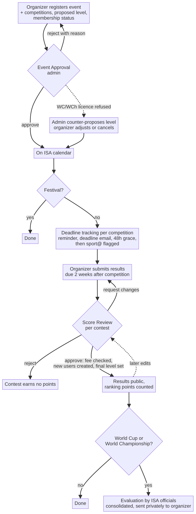
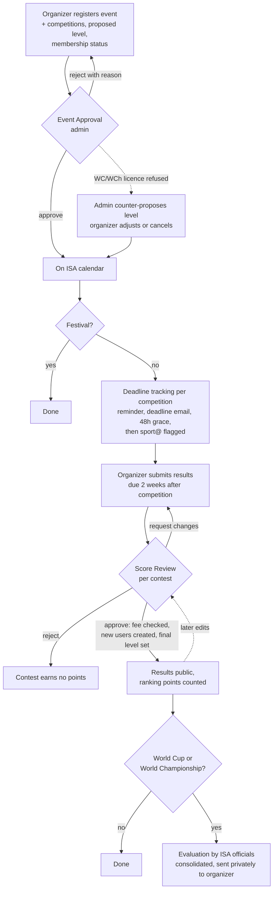

# Requirements: Events and Results Workflow

Status: **v1**, 2026-10-28. Agreed with Jonas in the project thread and a voice session; no implementation yet.
Rules source: ISA *Contest Size Overview* v6.0 (2026), page 1. Where this document and the sheet differ, this
document wins for SportHub; signed World Cup agreements may set stricter deadlines (not enforced by SportHub).

## 1. Goal and principle

SportHub covers an event's whole life: registration, ISA approval and calendar publication, deadline tracking,
results submission and review, and (for World Cups and World Championships) an evaluation afterwards.

**Principle: minimal change.** The existing submission form, "My events", "Edit scores", the Event Approval page
(`/admin/event-approval`) and the Score Review page (`/admin/score-review`) stay. The workflow is extended at the
beginning (levels, licences, deadlines) and at the end (results review per contest, evaluation). Section 10 lists the
few changes to existing behaviour.

**Out of scope (v1):** co-organizers and ownership transfer; fee payment handling (only a checkbox); enforcing
documentation rules; a separate competition object in the data; migration of existing events (left to developers).

## 2. Terminology and levels

- **Event**: the umbrella term. **Festival**: an event with no competitions.
- **Competition**: all contests of one discipline in an event (each of the 14 disciplines in the code is its own
  competition, so freestyle highline and speed highline are separate). At most one competition per discipline per
  event. One event can hold competitions at different levels.
- **Contest**: a division of a competition (men, women, mixed, youth, senior…).
- **Level**: set per competition; all its contests share it. The code's "Grand Slam" is shown as **National**.

| Level | 1st place pts | Min. field m/f | Licence | Info to ISA / announce / rules | Fee member / partner / third party |
|---|---|---|---|---|---|
| Challenge | 200 | 3 / 3 | no | 4 weeks / 4 weeks / 4 weeks | €0 / €0 / €30 |
| Open | 300 | 3 / 3 | no | 6 weeks / 6 weeks / 6 weeks | €0 / €0 / €50 |
| National | 600 | 5 / 3 | no | 2 months / 2 months / 2 months | €0 / €0 / €100 |
| Masters | 900 | 7 / 4 | no | 3 months / 3 months / 3 months | €0 / €100 / €410 |
| World Cup | 2000 | 9 / 5 | **yes** | 3 months / 3 months / 3 months | €0 / €300 / €600 |
| World Championship | 3000 | 11 / 6 | **yes** | 6 months / 4 months / 4 months | €0 / €400 / €1000 |

Results are due **2 weeks after the competition** at every level.

## 3. Actors

- **Visitor**: sees approved events on the calendar and approved results.
- **Organizer**: any signed-in user who pressed "Become an Organizer" on the dashboard (exists today, no approval).
  Registers events, confirms deadlines, submits and edits results of their own events.
- **Admin** (`role: admin`): approves events and results, sets levels, edits anything; every admin edit is logged.
- **Evaluator**: any SportHub user an admin picks for a World Cup or World Championship evaluation (no new role).

## 4. Workflow

## 5. Registration and Event Approval

- The organizer uses today's submission form: name, city, country, dates, website, links, logo, and contests. A
  future event needs no judges or results.
- **Per competition** the organizer proposes a level and declares member, partner or third party (a "?" tooltip
  explains each). The form forces all contests of a discipline to the same level and shows the fee from §2.
- Submitting sends the event to **Event Approval** as today. Nothing is public before approval. The admin should
  answer within 1 week (Challenge, Open) or 2 weeks (other levels); after that sport@ gets a reminder.
- The admin **approves** (event goes on the calendar) or **rejects** with a reason (back to draft, organizer
  emailed). On approval the admin confirms each competition's proposed level and membership status.
- **World Cup / World Championship** show as "licence pending" until the admin confirms the licence. If refused, the
  admin sets a lower level as a counter proposal; the organizer is emailed and can adjust or cancel. That level is
  then only proposed.
- **Public level display:** the level icon is hidden until ISA confirms it: on licence confirmation for World Cup and
  World Championship, after results approval for all other levels.
- **Festivals** end here.
- **After approval**, "Edit event" changes only event details (name, dates, links, logo) and can add contests;
  judges and results change only through "Edit scores" (§7). Date changes recalculate deadlines; if a deadline has
  then already passed, sport@ is emailed. A **cancelled** event leaves the calendar, its record stays, and sport@ is
  notified. Admins can edit or remove any event at any time; the organizer is emailed.

## 6. Deadlines

- Deadlines count from **each competition's own dates**, using the table in §2: deadlines before the competition
  count back from its **earliest contest start**, the results deadline counts from its **latest contest end**.
- SportHub checks "information sent to ISA" (submission date) and "results submitted" automatically. The organizer
  confirms the others (public announcement incl. athlete invitation, rules published) by a link in the email, on
  trust and without evidence.
- World Cup and World Championship licence fees are due **30 days before** the competition and tracked the same way.
- Per deadline: **reminder 1 week before → email on the deadline date with a "confirm done" link → 48-hour grace →
  email to sport@** if still unconfirmed.
- An event registered (or moved) after a deadline has passed triggers an immediate email to sport@.
- SportHub only flags; the admin decides about consequences (e.g. the final level at results approval).

## 7. Results submission (unchanged core)

- Organizers enter judges and results in today's form or "Edit scores". Judges and results stay required for every
  past event at every level, as today.
- **Points** are always calculated from rank, level and field size. Organizers can no longer edit them; admins can
  override. Ties get equal points and the next place is skipped (3rd, 3rd, 5th).
- **Mixed contests**: athletes get the points of their actual place, counted in the ranking of their profile gender
  (works today).
- **New athletes and judges**: as today, the organizer enters name, email, gender and country when no profile
  exists. New: a "similar profile exists" warning while typing.
- An optional documentation/video links field per contest; not enforced.

## 8. Results review

- **Score Review** handles every contest's results: first submissions (new) and edits of published results (today).
  Review is **per contest**.
- **Nothing counts before approval**: unapproved results do not appear in rankings, athlete profiles or on the
  public event page; organizer and admins see them as "awaiting review".
- Actions: **Approve**, **Request changes** (comment required), **Reject** (reason required; the contest earns no
  points), and direct admin **edit** (logged; the organizer is emailed what changed).
- Before approving, the admin:
  - creates each new athlete or judge profile (this is the duplicate check);
  - ticks **"licensing fee received"** when the fee for the competition is above €0;
  - sets the competition's **final level** when approving its first contest; the other contests inherit it, and a
    later level change recalculates all of them. SportHub shows each contest's field size next to the level's
    minimum; there is no automatic rule, and contests below 3 athletes are the admin's call. Licensed World Cups and
    World Championships keep their level.
- **Edits after publication** stay pending; the published results remain live and unchanged until approved.

## 9. Evaluation (World Cup and World Championship)

- After a competition's results are published, an admin picks evaluators (ISA officials who attended; any SportHub
  user). Each gets an email with a link; they log in to fill in the form. 2 weeks to respond, one reminder.
- Ten statements, each rated strongly disagree / disagree / neutral / agree / strongly agree (all phrased so
  "strongly agree" is best):
  1. All deadlines were met (communication before the event, rules published, results published by the organizer).
  2. Safety and rigging met ISA standards.
  3. Judging was done properly, with qualified judges and the official judging system.
  4. Athletes were well looked after.
  5. The athletes' level matched the competition level, taking wild cards into account.
  6. Documentation and media coverage were adequate.
  7. The venue was suitable.
  8. The event was well run on the day.
  9. Prizes and awards were delivered as announced.
  10. The published rules were applied consistently.
- Plus an open comment and an overall rating: below / met / exceeded expectations.
- An admin consolidates the answers and sends the feedback to the organizer. Private between ISA and organizer.

## 10. Changes to existing behaviour

1. **Ranking bug fix:** results of pending or rejected events currently count in rankings and show on profiles,
   because participation entries are written on save. Only approved contests may count.
2. **Review gap:** first results added to an already approved event currently go live unreviewed; they now go to
   Score Review.
3. **Edit event loophole:** "Edit event" currently re-creates all contests and results without review; after
   approval it no longer touches judges or results.
4. Points read-only for organizers; level per competition instead of per contest; level icon hidden until confirmed;
   Event Approval answers per level; Score Review gains first submissions, request changes and reject reasons.

## 11. Notifications and infrastructure

Emails go over the SMTP setup built for records and firsts (depends on PR #113); without SMTP they are only logged.
A failed email never blocks an action. One **daily scheduled job** checks all deadlines and sends what is due.
Admin emails go to **sport@slacklineinternational.org**.

| Event | To |
|---|---|
| Event submitted; approval overdue; licence decision needed | sport@ |
| Event approved / rejected / edited or removed by admin; licence confirmed or counter-proposed | organizer |
| Deadline reminder, deadline day (confirm link) | organizer |
| Deadline unconfirmed after 48 h; late registration or date change past a deadline; cancellation | sport@ |
| Results submitted / edit submitted | sport@ |
| Results approved / changes requested / rejected / admin edit | organizer |
| Results published | every athlete in them; new athletes and judges also get a "you have a SportHub profile" email |
| Evaluation request and reminder | evaluator |
| Consolidated evaluation | organizer |

## 12. Open issues

None. Event rejection takes a reason and an email; there is no "changes requested" state at event level.
